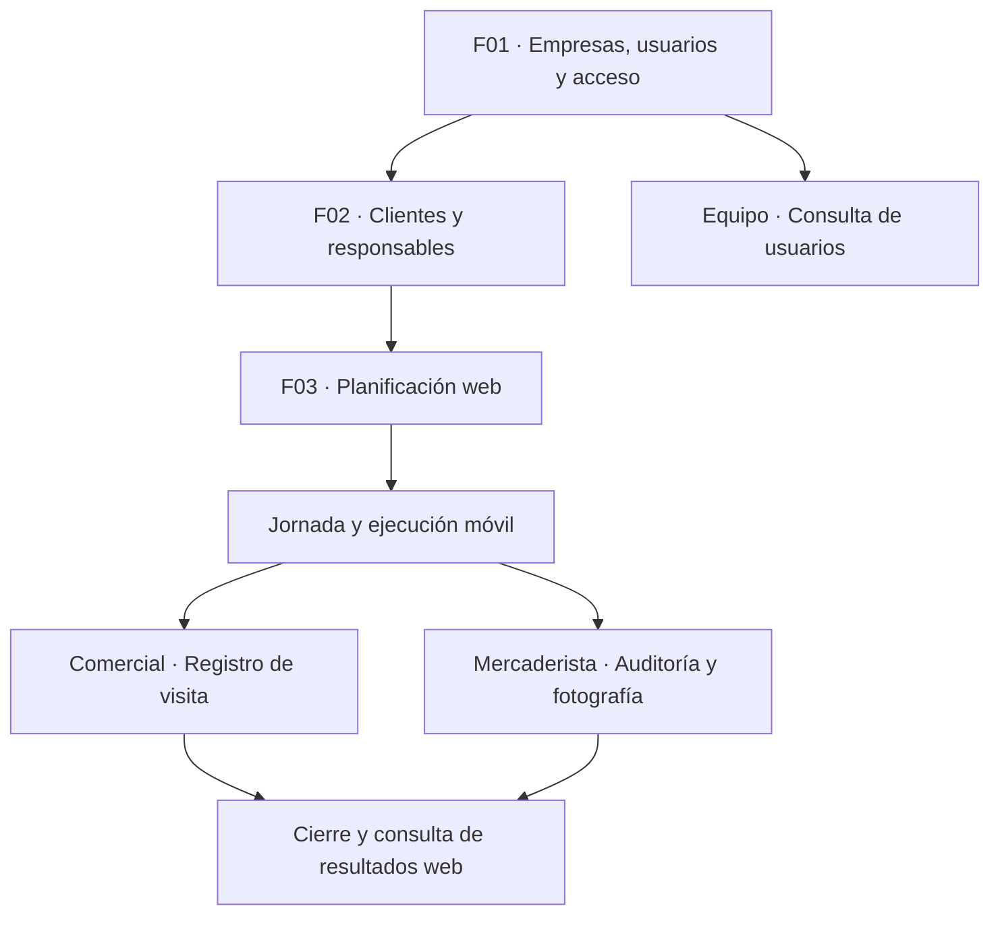

# Negocio, actores y mapa general

El propietario habilita empresas y cuentas. Cada empresa prepara clientes y responsables, planifica visitas y consulta lo que el personal ejecuta en campo. Los procesos están conectados, pero no forman una única secuencia obligatoria para todos los usuarios.

## Actores y conceptos

| Concepto | Responsabilidad o significado |
|---|---|
| Propietario global | Crea empresas y usuarios, gestiona activación y suspensión. Su sesión es independiente de una empresa. |
| Gerencia | Consulta equipo, gestiona clientes y responsables, planifica y supervisa visitas con sus permisos efectivos. |
| Comercial | Ejecuta su jornada y visitas asignadas en móvil. |
| Mercaderista | Ejecuta jornada y visitas; una visita atendida requiere auditoría de exhibición y fotografía. |
| Empresa | Organización con datos y accesos separados de las demás. |
| Pertenencia | Relación del usuario con empresa, rol y estado propios. |
| Cliente | Negocio que recibe visitas; no es un usuario del sistema. |
| Responsable | Comercial o Mercaderista asignado a un cliente. |
| Jornada | Trabajo de un responsable asociado a una fecha de negocio de la empresa. |

El rol y los permisos efectivos se validan en el backend. Que un trabajador sea interno o externo no debe confundirse con su rol. No se verificó una pantalla de administración de proveedores de personal.

## Mapa general

Las flechas muestran dependencias. No hace falta crear otra empresa o cliente por cada visita. Equipo es una consulta de apoyo de F01. [Abrir los recorridos](flujos/recorridos.md).

## Reglas compartidas

- Los usuarios de empresa acceden a los datos de su empresa según sus permisos; mostrar u ocultar un botón no sustituye autorización.
- Suspender una empresa revoca sus sesiones y bloquea acceso y gestión de usuarios. Reactivarla conserva los estados individuales anteriores; no reactiva a quien estaba desactivado.
- La fecha de negocio depende de la zona horaria. El formulario actual de empresa utiliza Lima. El servidor registra las horas de ejecución.
- La operación móvil requiere conexión. Reintentar una operación incierta con la misma clave evita duplicados; no significa sincronización offline.

## Dirección futura

Se conversó permitir que Comercial y Mercaderista ejecuten sus tareas también desde web. Es una intención futura, no una equivalencia completa disponible hoy. Cuando se implemente, ampliar F03 con la variante web conservando las reglas del negocio. No se incorporan los módulos ocultos como compromisos de evolución.
